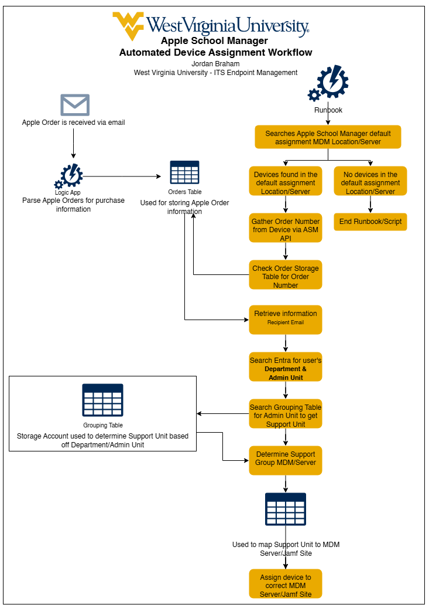
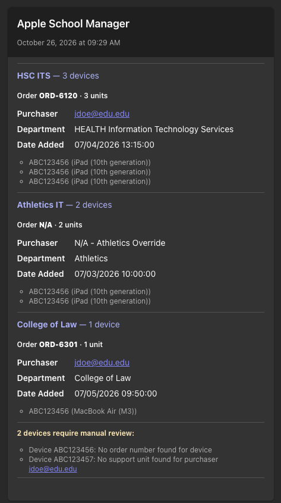

# Automating Device Assignments in Apple School Manager

Automatically routing new Apple devices to the right MDM server in Apple School Manager, using purchase data and the Apple School and Business Manager API, before the device ever reaches the end user.

> This repository is a project overview and presentation companion. Source code, configuration, and environment-specific details are intentionally not included.

**Presentation slides:** [Automating device assignments in Apple Business/School Manager (PDF)](slides/Automating_Device_Assignments_in_ASM.pdf)

| 6 months | 200+ | ~350 | 99% | 15+ hours |
|---|---|---|---|---|
| in production | orders processed | devices assigned | accuracy | of manual work saved |

---

## The problem

West Virginia University has a decentralized IT support model. Central IT runs Jamf Pro and Apple School Manager (ASM), and each college IT unit gets its own Jamf Pro site. That adds up to **17+ Jamf Pro sites**, each with its own MDM server in ASM for Automated Device Enrollment, plus hundreds of orders a year and thousands of users.

Every new device has to land in the right MDM server, or it enrolls into the wrong site. The process used to look like this:

1. An Apple shipment notification arrives.
2. A ticket is created.
3. A service desk technician looks up the purchaser, works out their support unit, and assigns each device in ASM by hand.

It works, but it has weak spots:

- **Human error.** Lookups and manual assignments can go wrong.
- **Timing.** Split shipments show up in ASM at different times, so devices get missed.
- **Blind spots.** Devices bought through channels that send no shipment email, like cellular contracts, never trigger a ticket at all.

A catch-all **"Default Assignment"** MDM server guarantees that every device still enrolls somewhere. Someone still has to notice it and move it.

## The opportunity

At WWDC 2025 Apple released the **Apple School and Business Manager API**. For the first time, an organization could programmatically:

- list devices assigned to a specific MDM server
- look up device details, including the order number
- reassign devices between MDM servers

That made it possible to take people out of the routine part of the loop.

## The solution

The workflow runs in Microsoft Azure and has two halves.

### 1. Data collection: capture who bought what

- Apple shipment notification emails go to a dedicated mailbox.
- An **Azure Logic App** picks up each new notification and parses out the order details, including the Apple sales order number and the purchaser.
- Those details go into an **Azure Storage Table**. The table drives the automation and also gives us a searchable history of every Apple order. (Email is not a backup.)

### 2. Device processing: put each device where it belongs

A scheduled **Python runbook in Azure Automation**:

1. Checks the **Default Assignment** MDM server in ASM for new devices. If it's empty, it stops.
2. Gets the **order number** for each device from the ASM API.
3. Matches that order number to the stored shipment record to find the **purchaser**.
4. Looks the purchaser up in **Microsoft Entra ID** and reads their **Administrative Unit**.
5. Maps the Administrative Unit to a **support unit**, and the support unit to its **MDM server / Jamf Pro site**.
6. **Reassigns the device** to that MDM server through the ASM API.

When the device is powered on, Automated Device Enrollment sends it straight to the correct Jamf Pro site. Nobody had to look anything up.

The mappings live in data rather than in code. When a support unit is renamed or a new site is added, the change is a new table row, not a code change.

### Visibility

Each run is logged, and the results are posted to **Microsoft Teams** as one Adaptive Card per run:

- Assigned devices are **grouped by support unit**, with the order, purchaser, department and serial numbers for each.
- One card can cover **several orders and devices** in a single run.
- Anything the automation couldn't resolve, such as a device with no order number or a purchaser with no support unit, is listed under **"require manual review"** so the team can follow up.

  

Example card shown with sample data.

## Rollout

- **Read-only first.** For about six weeks the automation ran in a "would have moved" mode. It reported every decision to Teams without changing anything, while the service desk kept assigning devices by hand. That made it easy to check its accuracy and fix edge cases.
- **Then production.** Once the results matched, device moves were turned on, and routine assignments came off the service desk's plate.

## Impact

In its first six months in production:

- **200+ orders** processed
- **About 350 devices** assigned automatically
- **99% accuracy**
- **15+ hours** of manual assignment work saved

## Lessons learned

- **Identity data is messier than you expect.** Purchaser emails don't always match a user's primary address, and some users belong to more than one Administrative Unit. Matching needed fallbacks and clear rules.
- **Every organization has exceptions.** A few units need explicit overrides. Keeping those as data, not special-case code, keeps the logic readable.
- **Unknowns need a home.** Anything the automation can't resolve stays in the Default Assignment server and is flagged in Teams, so nothing silently falls through.
- **Build trust before you flip the switch.** A read-only phase with good reporting made the move to production an easy decision.

## Tech stack

| Area | Tools |
|---|---|
| Device management | Apple School Manager, Apple School and Business Manager API, Jamf Pro (Automated Device Enrollment) |
| Automation | Azure Automation (Python runbook), Azure Logic Apps |
| Data | Azure Storage Tables |
| Identity | Microsoft Entra ID (Administrative Units), Microsoft Graph |
| Notifications | Microsoft Teams (Adaptive Cards via webhook) |

## Resources

- [Apple School and Business Manager API](https://developer.apple.com/documentation/apple-school-and-business-manager-api)
- [Implementing OAuth for the Apple School and Business Manager API](https://developer.apple.com/documentation/apple-school-and-business-manager-api/implementing-oauth-for-the-apple-school-and-business-manager-api)
- [Azure Automation documentation](https://learn.microsoft.com/azure/automation/)
- [Azure Logic Apps documentation](https://learn.microsoft.com/azure/logic-apps/)
- [Administrative units in Microsoft Entra ID](https://learn.microsoft.com/entra/identity/role-based-access-control/administrative-units)

## Author

**Jordan Braham**, Endpoint Management, West Virginia University

Questions or want to compare notes? Reach out here [brambler@brambler.tools](mailto:brambler@brambler.tools) or [LinkedIn](https://www.linkedin.com/in/jordan-braham/)
